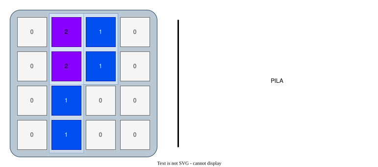
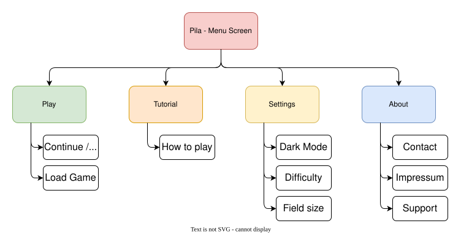

## PILA
In this [Flutter](https://flutter.dev/) game you have to stack different tetris forms to match a given pattern of numbers, or to reduce stacks of numbers to flatten all fields to zero to finish the level. 

This cross-platform app is developed for Android and iOS devices.

_Naming_

_The name "PILA" originates from spanish and refers to "stack" or "pile", which corresponds to the number stacks which have to be flattened by the players to finish the level successfully._

### Concept
The following diagram shows the first basic concept for designing the app and different screens. 

Notes to `Play`:
- `Start Game`: The player can continue with the game / level.
- `How to play`: The player can learn the basics with 1 to 3 levels which explain the mechanics and rules and how to play the game.

Notes to `Settings`:
- `Light / Dark Mode`: The player can select between dark mode and light mode, as well as color settings for color blindness.
- `Game Mode`: 
  - `easy`: Single fields of each element do have different values (not just 1), this simplifies the game due to easier identifiable positions.
  - `classic`: All single fiels of each element do have the value 1.
- `Field Size`:
  - The player can choose between 4x4, 5x5 or 6x6 field size.

Notes to `About`:
- `Version`: Version of the game (e.g. `MAJOR.MINOR.PATCH` version)
- `Impressum and Contact`: Contact information about the game developer.
- `Support`: The player can make a voluntary financial contribution to the development of the game 

## Development
This game is developed using [Flutter](https://flutter.dev/). 

- [ ] First step, will be the `Menu screen`
- [ ] Second, the `About` screen with its submenues shows text and basic information
- [ ] Third, the `Settings` screen and its submenues offers some parameters to be changed or switched by the user
- [ ] Next, the `How to play` should provide the first playable levels, which are available in the `Play` screen
- [ ] Finally, the `Play` screen loads the first level for the users to play

Mechanics to implement:
- [ ] Define the square game field
- [ ] Implement the seven element forms to keep also their shape after rotation
- [ ] Implement the summation of each number stack
- [ ] Implement the algorithm to setup the stacked level to play
- [ ] Implement the boundary limitations of the forms to not overlap with the boundary of the game field
- [ ] Implement the level screen with the game field and the different element forms and buttons at the bottom of the screen
- [ ] Implement the rotation mechanism for rotating smartphone screen

Build and deploy the app:
- [ ] Gather information about deploying an app to app stores
- [ ] Android with Google Play Store
- [ ] iOS with App Store

Testing the app
- [ ] Testing during development
- [ ] Testing by first beta testers
