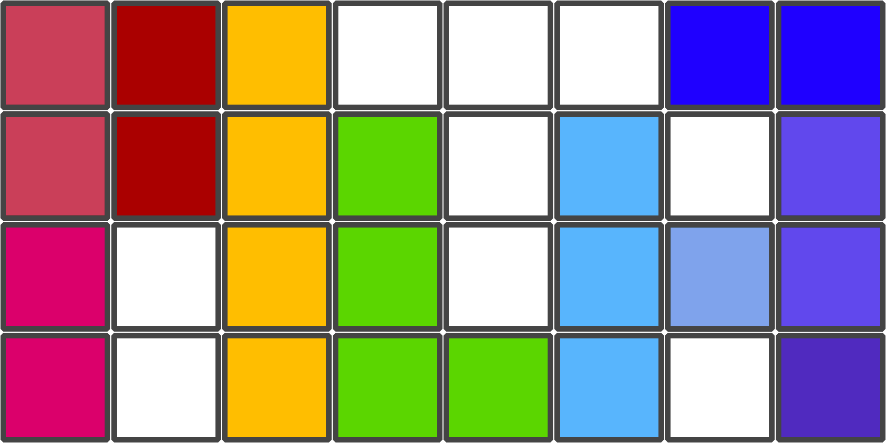

## PILA
In this [Flutter](https://flutter.dev/) game you have to reduce digits in the grid to zero to clear the level. 

This cross-platform app is developed for Android and iOS devices.

>  _The name "PILA" originates from spanish and refers to "stack" or "pile", which corresponds to the digit stacks which have to be zero-ed to clear the level successfully._

### How to play

> _Main Screen_

All digits in the central grid have to be reduced down to zero to clear the level. To achieve this, use each of the seven different Tetromino tiles below. Each digit in the grid covered by the selected Tetromino tile is reduced by one. 

Select one Tetromino tile and move it via swiping left/right and up/down to a fitting position, or rotate it using the `Rotate` button below. Then, `Apply` the Tetromino in the grid. Each level is build out of a specific set of Tetromino tiles. 

To undo the last applied Tetromino, use the `Revert` button, or hold it to reset the entire level. 

To generate a new level just reload the screen by dragging the screen from top to bottom.

Via the `Burger menu` in the upper left corner you get to the `Settings`, `Feedback` or the `About` options. To show the rules how to play, check out the `Help` button in the upper right corner.

## Feedback
Feel free to let me know about bugs or features you wish to be added to the game in the [Github Issues of this project](https://github.com/FOehlschlaeger/pila/issues). 

## Development
This game is developed using [Flutter](https://flutter.dev/). 

### Upcoming Features
- [x] Design buttons and icons
- [x] Design main screen
- [x] Implement "About screen"
- [x] Implement "Feedback screen" with link to github
- [x] Implement "Help screen" with instructions on how to play
- [ ] Implement in settings to set language
- [ ] Implement in settings to set dark mode
- [ ] Handle state management of level state in backend
- [x] Implement classes for tiles
- [x] Implement basic functions for level state changes in backend
- [ ] Implement reloading function to generate a new level when reloading the app
- [ ] Implement function buttons to display a tile in the field
- [ ] Implement function to move a tile vertically and horizontally via interaction
- [ ] Implement function to revert a tile placement via button
- [ ] Implement function to apply a tile via button
- [ ] Implement function to rotate a tile via button
- [ ] Implement holdable Button on reset the current level via button
- [ ] Optional: Rotate all widgets in place when device is rotated
- [ ] Optional: Add gifs or animations to help screen
