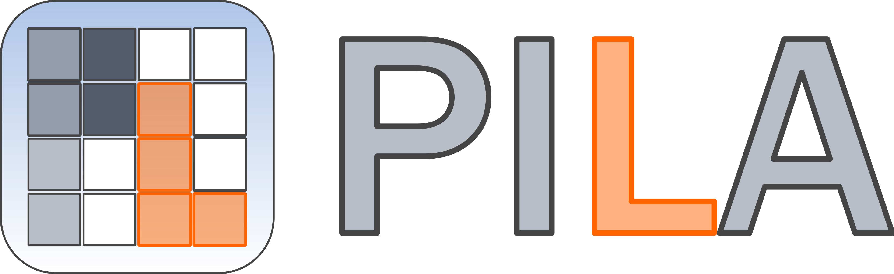
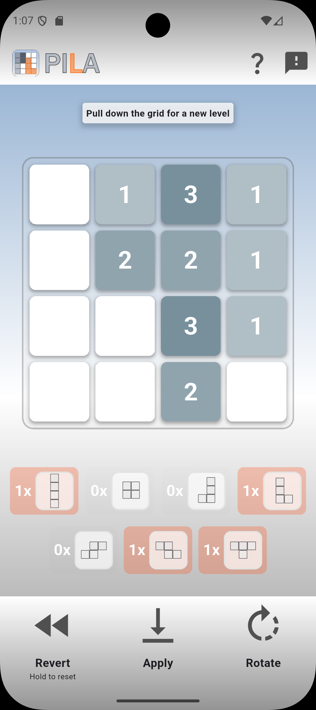
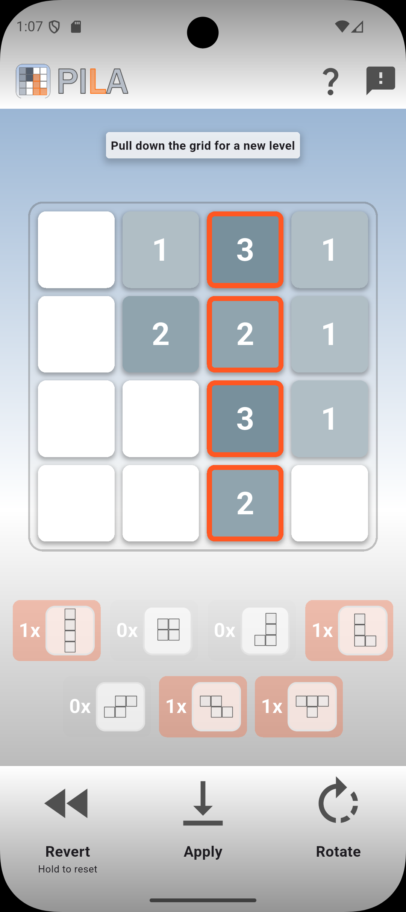
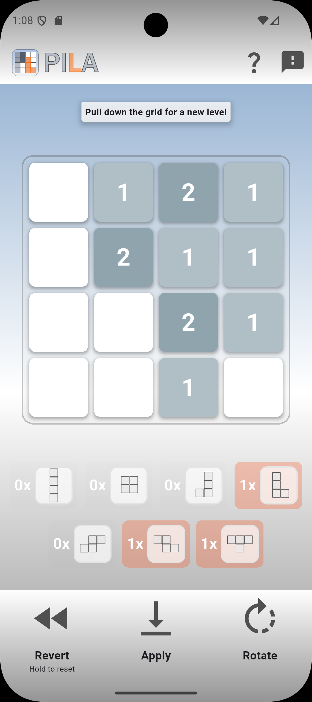
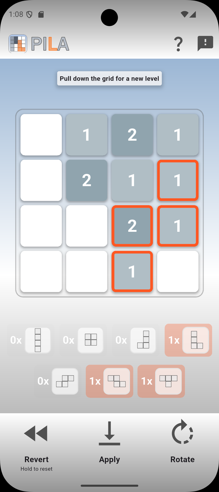
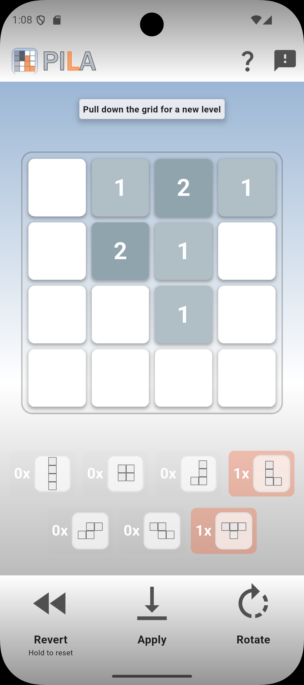
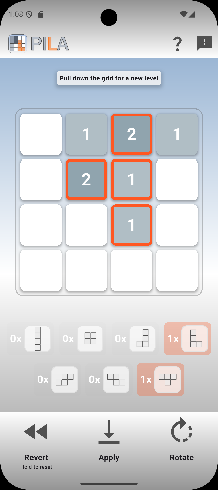
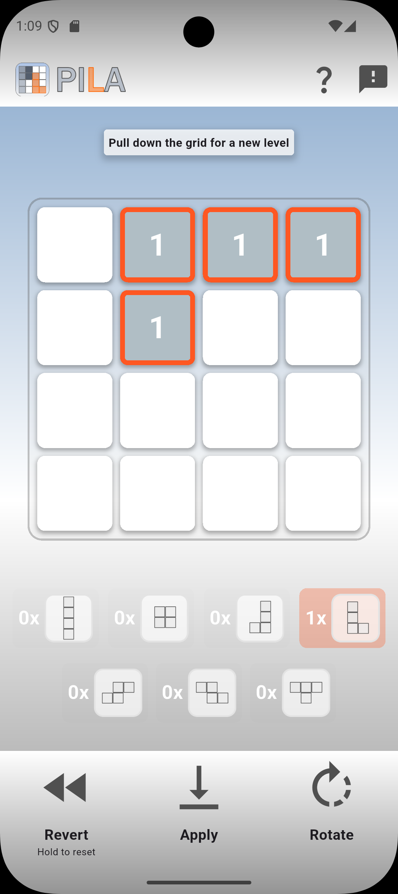
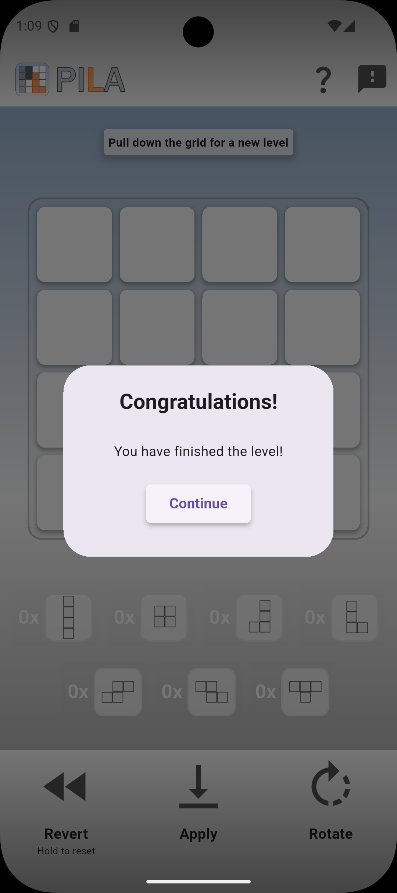

    

---
In this game you have to reduce digits in the grid to zero to clear the level. 

> *The name "PILA" originates from spanish and refers to "stack" or "pile", which corresponds to the stacks of tetromino tiles which have to be reduced down to zero to clear the level successfully.*

## How to play
All digits in the central grid have to be reduced down to zero (i.e. white fields) to clear the level. To achieve this, use each of the seven different tetromino tiles below. The tetromino tiles make use of four digits. Each digit in the grid covered by the selected tetromino tile is reduced by one. In other words, the digits in the grid show how many times a tetromino tile uses this field of this digit.

Each level is build out of a specific set of tetromino tiles. Select one tetromino tile by using the tetromino buttons. The counter besides the tetromino buttons show the remaining number of this tile left to use. Move the marked tile in the grid via swiping left/right and up/down in the area of the buttons at the bottom part of the screen to a fitting position, or rotate it using the `Rotate` button below. Then, `Apply` the tetromino in the grid to reduce the marked digits by one. 

To undo the last applied tetromino, use the `Revert` button, or hold it to reset the entire level. 

To generate a new level just reload the screen by dragging the screen from top to bottom.

To show the rules, check out the `Question mark` button in the upper right corner. For Feedback and some general information about the application use the `Feedback` button. 

#### Example
The following screenshots show a sequence on how to play this example level.

> *Step-by-step example level on how to play*
>
> *In this level, four different tetrominos are used as indicated by the orange marked buttons below the grid.* 
>
> *First, the `I`-tetromino is selected and applied as marked in the second image. The correspoding counter below the grid goes from `1x` to `0x` and the four digits covered by the tetromino are reduced by one.*
>
> *Then, the `Z`-tetromino is rotated and shifted before applying.*
>
> *The two remaining tetrominos `L` and `T` are then rotated and shifted as well to match and reduce the remaining fields in the grid.*
>
> *After this action, the level is finished. By hitting `Continue` a new level is immediately created to continue playing.*

## Feedback
Feel free to let me know about bugs or features you wish to be added to the game in the [Github Issues of this project](https://github.com/FOehlschlaeger/pila/issues). 

## Development
This cross-platform app is developed for Android using [Flutter](https://flutter.dev/). 
